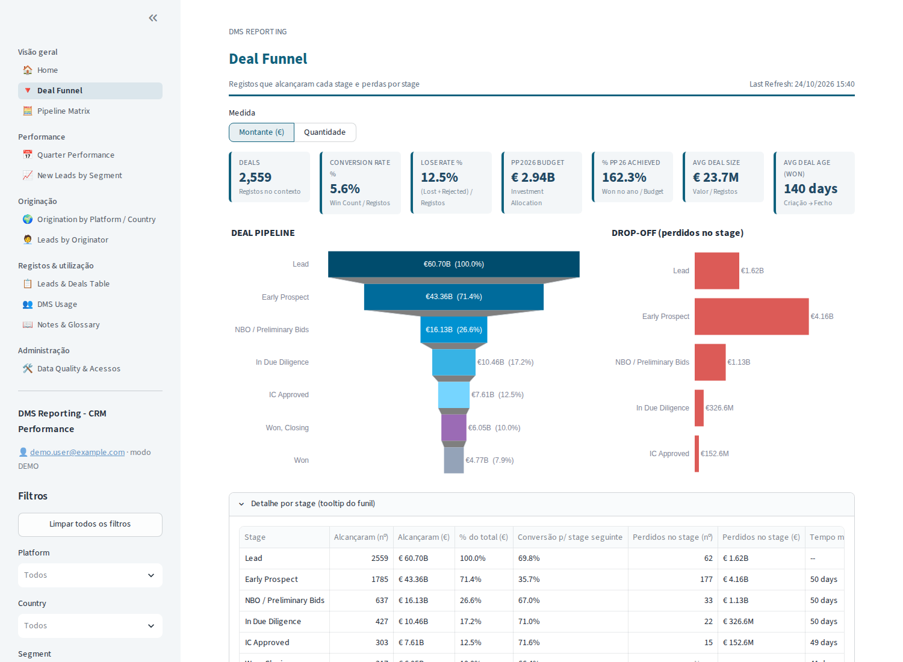
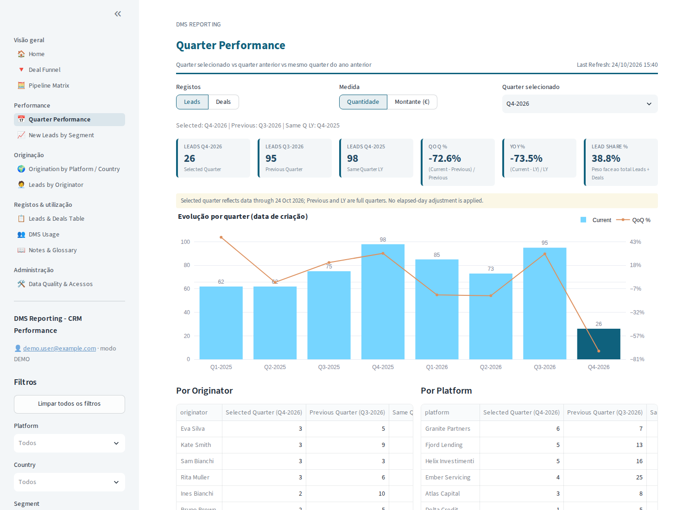
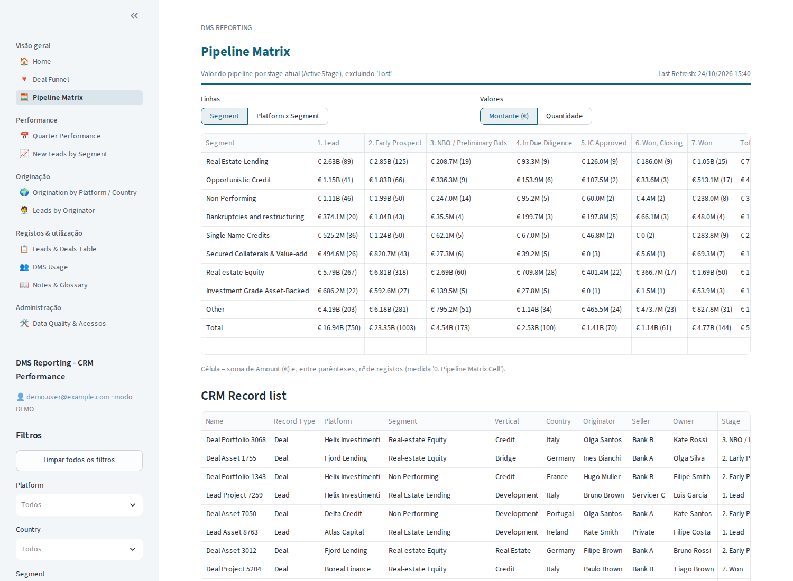
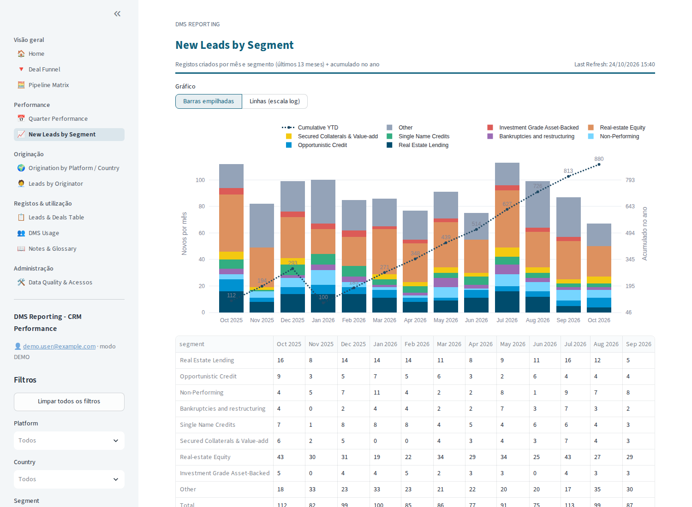

# CRM Performance Reporting — Databricks App

Migração do relatório Power BI **CRM_Performance_Reporting_MVP_v1** ("DMS Reporting") para
**Databricks**: dados no Unity Catalog (bronze → silver → gold), segurança por utilizador
(RLS) e uma **Databricks App** em Streamlit que substitui as 15 páginas do relatório.

## Comece aqui
| Documento | Para quê |
|---|---|
| [`docs/00_Analise_PowerBI.md`](docs/00_Analise_PowerBI.md) | o que existia no PBI, páginas → app, **achados** (A1 Leads DEV/PRD, A2 RLS em Excel local, …) |
| [`docs/01_Guia_Implementacao.md`](docs/01_Guia_Implementacao.md) | **guia passo a passo** (infraestrutura, deploy, produção, operação, troubleshooting) |
| [`docs/02_Mapeamento_DAX_SQL.md`](docs/02_Mapeamento_DAX_SQL.md) | onde está cada passo Power Query / coluna / medida DAX |
| [`docs/03_Testes_UAT.md`](docs/03_Testes_UAT.md) | testes automáticos, números de referência e checklist de aceitação |

## Arquitetura
```
Synapse Serverless (views rpt.*, PRD + DEV)  ──Lakehouse Federation──►  bronze
Excel da lista de acessos ──► Volume ref.landing/rls                      │ job diário (06:00)
                                                                           ▼
                        silver: Power Query + 40 colunas DAX + preparação RLS
                                                                           ▼
                        gold:   views seguras (current_user()) ──► SQL Warehouse ──► Databricks App
```

## Estrutura
```
databricks.yml            bundle (targets dev/prod, variáveis)
resources/                job de ETL e app
sql/                      00/02/40 = execução manual por admin · 01-30, 90 = job
src/                      notebooks do job + crm_etl (código partilhado)
app/                      Databricks App (Streamlit): app.py, views/ (páginas), crm_app/ (lógica)
tools/                    geração de dados fictícios, demo local, extração do PBIX
tests/                    paridade com o PBI + testes das medidas
sample_data/              dados FICTÍCIOS (CSV) para dev/demo
```

## Leads: DEV ou PRD?
No Power BI a tabela Leads vinha da base **DEV** (achado A1). As duas versões são ingeridas
e o parâmetro `leads_source_active` (`DEV` por omissão, igual ao PBI) escolhe a ativa.
Comparação lado a lado na página *Administração → Leads DEV vs PRD*.

## Arranque rápido (demo local, sem Databricks)
```bash
pip install -r requirements-dev.txt
python tools/generate_sample_data.py && python tools/build_demo_db.py
pytest -q tests/
cd app && APP_BACKEND=duckdb streamlit run app.py
```

## Deploy (resumo — detalhes no guia)
```bash
databricks auth login --host https://<workspace>
databricks bundle validate -t dev
databricks bundle deploy   -t dev
databricks bundle run crm_reporting_etl -t dev
databricks bundle run crm_reporting_app -t dev
```

## Capturas de ecrã (modo demo, dados fictícios)
| Deal Funnel | Quarter Performance |
|---|---|
|  |  |
| **Pipeline Matrix** | **New Leads by Segment** |
|  |  |
